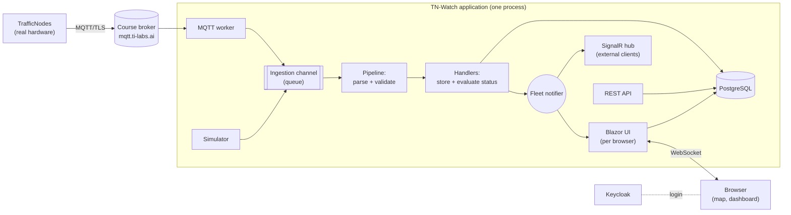

# TN-Watch – Implementation Guide

> What was built, how it works, and why it was built that way.
> Goal: after reading this you can find your way around every folder and file of the repository.
> As of 19.11.2026 (branch `feature/mvp-implementation`).

**Contents**

1. [The big picture](#1-the-big-picture)
2. [The life of one message](#2-the-life-of-one-message)
3. [Annotated file tree](#3-annotated-file-tree)
4. [The five modules in depth](#4-the-five-modules-in-depth)
5. [How the UI maps to the mockups](#5-how-the-ui-maps-to-the-mockups)
6. [The simulator](#6-the-simulator)
7. [Several users at the same time](#7-several-users-at-the-same-time)
8. [Configuration, secrets and security](#8-configuration-secrets-and-security)
9. [Tests and quality assurance](#9-tests-and-quality-assurance)
10. [Build, CI and deployment](#10-build-ci-and-deployment)
11. [Requirements traceability](#11-requirements-traceability)
12. [Key decisions and trade-offs](#12-key-decisions-and-trade-offs)
13. [Known limitations and open points](#13-known-limitations-and-open-points)
14. [How to extend the system](#14-how-to-extend-the-system)

---

## 1. The big picture

TN-Watch is **one ASP.NET Core application** (a *modular monolith*, [ADR-01](adr/ADR.md#adr-01-architektur-stil-modularer-monolith-vs-microservices)) plus two supporting containers: PostgreSQL and Keycloak. Inside the application, the code is split into five projects ("modules") with clear dependencies:



| Project | Responsibility | Depends on |
|---|---|---|
| [`TNWatch.Domain`](../src/TNWatch.Domain) | Business rules: status classes, thresholds, smoothing, SoC estimate, node aggregate, interfaces | nothing |
| [`TNWatch.TelemetryIngestion`](../src/TNWatch.TelemetryIngestion) | Getting messages in: MQTT client, parsing/validation, queue + pipeline, simulator | Domain |
| [`TNWatch.Persistence`](../src/TNWatch.Persistence) | Database: EF Core model, migrations, repository, read queries | Domain |
| [`TNWatch.Alerting`](../src/TNWatch.Alerting) | Reacting to messages: store + evaluate + log status changes, offline watchdog | Domain |
| [`TNWatch.WebUI`](../src/TNWatch.WebUI) | The host: wires everything together, Blazor UI, REST API, SignalR, login | all of the above |

**Why this split?** The modules only know each other through **interfaces in the Domain project** (`ITelemetryHandler`, `ITelemetryRepository`, `IFleetNotifier`, …). For example, the ingestion module hands a validated reading to "some `ITelemetryHandler`" without knowing that Alerting implements it or that PostgreSQL exists. That keeps every module testable on its own (NFA06/NFA07) and lets us swap parts without touching the others.

---

## 2. The life of one message

Follow one telemetry message from the broker to the colour of a pin. Every step names the file where it happens.

| # | What happens | Where |
|---|---|---|
| 1 | A TrafficNode publishes `{"voltage_mV": 12003.75, "current_mA": 50.00, …}` on `traffic-nodes/TN0001/measurements` (real message from the course broker). | outside our system |
| 2 | The **MQTT worker** is subscribed to `traffic-nodes/+/measurements` (and `traffic-nodes/#`) and receives the bytes. It does not parse them; it wraps them as a `RawMessage(topic, payload, receivedAt, source)` and writes them into the queue. | [`MqttIngestionWorker.cs`](../src/TNWatch.TelemetryIngestion/Mqtt/MqttIngestionWorker.cs), [`RawMessage.cs`](../src/TNWatch.TelemetryIngestion/RawMessage.cs) |
| 3 | The **ingestion channel** is a bounded in-memory queue (10,000 slots). Producers wait when it's full (back-pressure) instead of losing messages. | [`IngestionChannel.cs`](../src/TNWatch.TelemetryIngestion/IngestionChannel.cs) |
| 4 | The **pipeline** is the single consumer of the queue. It classifies the message (telemetry, battery event or unknown) by topic pattern and payload. | [`IngestionPipelineService.cs`](../src/TNWatch.TelemetryIngestion/IngestionPipelineService.cs) |
| 5 | The **parser** reads node ID and tenant from the topic, converts mV→V and mA→A, and checks plausibility (0 < U ≤ 20 V, \|I\| ≤ 50 A, valid GPS, sensible timestamp). Invalid messages are logged with a reason and counted, then dropped. | [`TelemetryParser.cs`](../src/TNWatch.TelemetryIngestion/Parsing/TelemetryParser.cs), [`TopicPattern.cs`](../src/TNWatch.TelemetryIngestion/Parsing/TopicPattern.cs), [`JsonFields.cs`](../src/TNWatch.TelemetryIngestion/Parsing/JsonFields.cs) |
| 6 | The result is a clean `TelemetryReading` (always volts, amperes, degrees). The pipeline opens a fresh DI scope (= fresh database context) and calls `ITelemetryHandler.HandleAsync`. | [`TelemetryReading.cs`](../src/TNWatch.Domain/Telemetry/TelemetryReading.cs) |
| 7 | The **telemetry processor** loads the node (or creates it), loads the previous 2 voltages, applies the reading to the node, and lets the **status evaluator** compute the new status from the mean of the last 3 voltages. | [`TelemetryProcessor.cs`](../src/TNWatch.Alerting/TelemetryProcessor.cs), [`TrafficNode.cs`](../src/TNWatch.Domain/Fleet/TrafficNode.cs), [`StatusEvaluator.cs`](../src/TNWatch.Domain/Status/StatusEvaluator.cs) |
| 8 | Measurement, updated node snapshot and (if the status changed) a status-change record are saved **in one database transaction** (NFA04). | [`TelemetryRepository.cs`](../src/TNWatch.Persistence/TelemetryRepository.cs) |
| 9 | Only after the commit, the processor publishes `NodeUpdated` (and `StatusChanged`) on the **fleet notifier**. It also records the latency "received → committed" for NFA01. | [`FleetNotifier.cs`](../src/TNWatch.Domain/Fleet/FleetNotifier.cs), [`IngestionStats.cs`](../src/TNWatch.Domain/Diagnostics/IngestionStats.cs) |
| 10 | Every open browser tab has its own **`FleetViewModel`** subscribed to the notifier. It updates its in-memory list and, at most ~3 times per second, tells the page to re-render. | [`FleetViewModel.cs`](../src/TNWatch.WebUI/State/FleetViewModel.cs) |
| 11 | The page passes the new node list to the **map component**, which sends it to Leaflet via JavaScript interop. Leaflet changes the pin's CSS class → the pin changes colour. (A node without GPS, like `TN0001` today, only appears in the dashboard table.) | [`Home.razor`](../src/TNWatch.WebUI/Components/Pages/Home.razor), [`FleetMap.razor`](../src/TNWatch.WebUI/Components/Fleet/FleetMap.razor), [`fleetMap.js`](../src/TNWatch.WebUI/wwwroot/js/fleetMap.js) |

Measured end to end at 20 messages/s: step 2 → step 8 takes 217 ms in the 95th percentile (NFA01 requires < 300 ms).

**What if a node stops sending?** Then no message arrives and steps 1–11 never run. That's why the [`OfflineWatchdog`](../src/TNWatch.Alerting/OfflineWatchdog.cs) checks every 60 s for nodes whose last contact is ≥ 30 min ago and switches them to *Offline* (same steps 8–11).

**Battery events** take the same route up to step 4. They are then parsed by [`BatteryEventParser.cs`](../src/TNWatch.TelemetryIngestion/Parsing/BatteryEventParser.cs) and handled by [`BatteryEventProcessor.cs`](../src/TNWatch.Alerting/BatteryEventProcessor.cs), which stores the event once (the `eventId` is the primary key) and sets the node's current battery serial.

---

## 3. Annotated file tree

Generated folders (`bin/`, `obj/`, `TestResults/`, `coverage/`) and the vendored JS libraries are omitted.

```
.
├── README.md                     Project spec (requirements F01–F10, NFAs, status rules) + getting started
├── TNWatch.sln                   Visual Studio solution: all src/, tests/ and tools/ projects
├── Directory.Build.props         Build settings for EVERY project: .NET 10, nullable, analyzers, warnings = errors
├── global.json                   Pins the .NET SDK to 10.0.x (rolls forward to newer 10.0 patches)
├── .editorconfig                 Code style + which analyzer rules are relaxed (and why, see comments)
├── .gitignore / .dockerignore    What git / the Docker build ignore (secrets: data/*.yaml, .env)
├── .config/dotnet-tools.json     Local CLI tools: dotnet-ef (migrations), reportgenerator (coverage report)
├── coverage.runsettings          Which assemblies count for test coverage (NFA07)
├── Dockerfile                    Builds the app image (2 stages: SDK build → small runtime image)
│
├── .github/workflows/
│   ├── ci.yml                    CI: build, format check, tests, coverage gate ≥ 80 %, Docker build
│   └── plantUML.yml              Renders docs/uml/*.puml to SVG on every push
│
├── data/                         Sample data from the course (input for parser tests and the simulator design)
│   ├── sample_msg.json           Real MQTT payload format (mV/mA, null GPS/time)
│   ├── traffic_devices_signals.csv  Real history of node TSN-002 (topic schema, voltage range)
│   ├── exchange.example.json     Battery exchange event (F10)
│   ├── discard.example.json      Battery discard event (F10)
│   ├── portbereiche.txt          Our port range on the course server (21300–21399)
│   └── tinf25d-…yaml             Group credentials – NOT in git (ignored)
│
├── deploy/                       Everything needed to run the full system with Docker
│   ├── docker-compose.yml        3 containers: app, db (PostgreSQL 16), keycloak
│   ├── .env.example              Template for secrets/ports → copy to deploy/.env (ignored)
│   ├── keycloak/tnwatch-realm.json  Keycloak realm: client, roles, demo users (imported at start)
│   ├── keycloak/enable-user-directory.sh  One-off upgrade of an existing realm for F11 (service account rights)
│   └── postgres/init/01-keycloak-database.sql  Creates the separate "keycloak" database
│
├── docs/
│   ├── README.md                 Index of the documentation
│   ├── IMPLEMENTATION.md         This file
│   ├── ToDo.txt                  Team notes
│   ├── adr/ADR.md                Architecture Decision Records (incl. addenda of 12.11.2026)
│   ├── architecture/workspace.dsl   C4 model (Structurizr DSL); c4/*.svg = exported diagrams
│   ├── interfaces/mqtt-contract.md  MQTT topics, payload fields, validation rules, broker findings
│   ├── mockup/*.pdf              The three UI mockups the web UI follows
│   └── uml/*.puml                Use case + activity diagram (PlantUML)
│
├── tools/
│   ├── TNWatch.MqttProbe/        Small console tool: read-only subscription to the broker, logs what arrives
│   └── replay-profile/           Script that extracts the simulator replay profile from data/*.csv
│
├── src/
│   ├── TNWatch.Domain/                   ── pure business logic, no framework dependencies
│   │   ├── Status/
│   │   │   ├── NodeStatus.cs             Enum: Unknown, Normal, Warning, Critical, Offline
│   │   │   ├── StatusRules.cs            Thresholds 12.4 V / 11.8 V, 30 min, window 3 (configurable)
│   │   │   └── StatusEvaluator.cs        THE status rule (README §7) incl. moving average
│   │   ├── Telemetry/TelemetryReading.cs One validated measurement (V, A, GPS, time, source)
│   │   ├── Battery/
│   │   │   ├── SocEstimator.cs           Voltage → state of charge % (12 V AGM curve, estimate)
│   │   │   └── BatteryEvent.cs           Exchange/discard event (F10)
│   │   ├── Fleet/
│   │   │   ├── TrafficNode.cs            Aggregate: master data + current snapshot + status transitions
│   │   │   ├── NodeSnapshot.cs           Read-only view of a node for UI/API
│   │   │   ├── ITelemetryRepository.cs   Write-side interface (implemented in Persistence)
│   │   │   ├── IFleetQueries.cs          Read-side interface + FleetSummary (KPI counts)
│   │   │   ├── Handlers.cs               ITelemetryHandler, IBatteryLifecycleHandler, ISimulatorControl
│   │   │   ├── IFleetNotifier.cs         Live-update events (NodeUpdated, StatusChanged, FleetReset)
│   │   │   ├── FleetNotifier.cs          Implementation; a failing subscriber can't break others
│   │   │   └── MeasurementDownsampler.cs Thins out long series for the chart (raw data stays for CSV)
│   │   ├── Assignments/                  F11 "who handles which node"
│   │   │   ├── NodeAssignment.cs         UserRef, NodeAssignment, AssignmentChange (live event)
│   │   │   ├── AssignmentRules.cs        Who may claim / assign / release (pure, unit-tested)
│   │   │   └── Interfaces.cs             IAssignmentStore, IAssignmentService, IUserDirectory
│   │   ├── Routing/GoogleMapsRouteBuilder.cs  Builds the Google Maps route/location links (F07)
│   │   ├── Export/MeasurementCsv.cs      CSV export format (F08)
│   │   └── Diagnostics/IngestionStats.cs Latency percentiles + counters (NFA01 evidence)
│   │
│   ├── TNWatch.TelemetryIngestion/       ── getting data into the system
│   │   ├── IngestionOptions.cs           Config: topic patterns, time zone, queue size
│   │   ├── RawMessage.cs                 Unparsed message (topic + bytes + receive time + source)
│   │   ├── IngestionChannel.cs           The bounded queue between producers and the pipeline
│   │   ├── IngestionPipelineService.cs   Background consumer: classify → parse → dispatch
│   │   ├── IngestionServiceCollectionExtensions.cs  Registers all of the above in DI
│   │   ├── Parsing/
│   │   │   ├── TopicPattern.cs           "traffic-device/{tenant}/…/{nodeId}/status" → regex + MQTT filter
│   │   │   ├── TelemetryParser.cs        JSON → TelemetryReading, units, plausibility (F01)
│   │   │   ├── BatteryEventParser.cs     JSON → BatteryEvent, local time → UTC
│   │   │   ├── JsonFields.cs             Tolerant JSON field access (null, strings, case-insensitive)
│   │   │   └── ParseResult.cs            "value or error reason" result type
│   │   ├── Mqtt/
│   │   │   ├── MqttOptions.cs            Config: host, port, TLS, client ID, reconnect interval
│   │   │   └── MqttIngestionWorker.cs    MQTT client: connect, subscribe, reconnect, certificate check
│   │   └── Simulation/
│   │       ├── SimulatorOptions.cs       Config: node count, interval, start state
│   │       ├── SimulatedNode.cs          One fake node: location, voltage profile (incl. replay), battery
│   │       ├── ReplayProfile.cs          Loads embedded real measurement series
│   │       ├── Profiles/tsn-002.csv      Real TSN-002 series (generated from data/, embedded resource)
│   │       └── TelemetrySimulator.cs     Background service + on/off switch (ISimulatorControl)
│   │
│   ├── TNWatch.Persistence/              ── the database
│   │   ├── TnWatchDbContext.cs           EF Core model: tables, schemas, indexes, UTC conversion
│   │   ├── Entities/*.cs                 Table rows for measurements, status changes, battery events
│   │   ├── TelemetryRepository.cs        Write side (ITelemetryRepository)
│   │   ├── FleetQueries.cs               Read side (IFleetQueries), one short-lived context per query
│   │   ├── AssignmentStore.cs            core.node_assignments (F11)
│   │   ├── PersistenceServiceCollectionExtensions.cs  DI registration + "migrate on startup"
│   │   ├── DesignTimeDbContextFactory.cs Only for `dotnet ef migrations add`
│   │   └── Migrations/                   Generated DB schema history (do not edit by hand)
│   │
│   ├── TNWatch.Alerting/                 ── reacting to incoming data
│   │   ├── TelemetryProcessor.cs         Store + evaluate + log status change + notify (F02, F06)
│   │   ├── BatteryEventProcessor.cs      Store battery event once + update node battery (F10)
│   │   ├── OfflineWatchdog.cs            Periodic offline check (+ AlertingOptions)
│   │   ├── AssignmentService.cs          F11 use cases, serialized with a lock, pushes live updates
│   │   └── AlertingServiceCollectionExtensions.cs  DI registration
│   │
│   └── TNWatch.WebUI/                    ── the host process and everything the user sees
│       ├── Program.cs                    Composition root: registers modules, middleware, endpoints
│       ├── appsettings.json              Default configuration (no secrets)
│       ├── appsettings.Development.json  Local overrides (dev DB, Auth:Mode=Development)
│       ├── Auth/
│       │   ├── AuthSetup.cs              OIDC + cookie login, role policy, /account/login|logout
│       │   ├── AuthOptions.cs            Config section "Auth"
│       │   ├── DevelopmentAuthHandler.cs Fake login for local development only
│       │   ├── CurrentUser.cs            Logged-in user → UserRef / "is Betriebsleiter?"
│       │   ├── UserDirectories.cs        Assignable users: Keycloak Admin API (prod) / config (dev)
│       │   └── Roles.cs                  "Betriebsleiter", "Techniker"
│       ├── Api/FleetApi.cs               REST endpoints /api/… with input validation (NFA08)
│       ├── Api/AssignmentApi.cs          REST endpoints for F11 (claim / assign / release)
│       ├── Realtime/TelemetryHub.cs      SignalR hub + broadcaster for external clients
│       ├── State/FleetViewModel.cs       Per-browser live fleet state (throttled re-render)
│       ├── Ui/Format.cs                  German number/date format, status labels and CSS classes
│       ├── Ui/MapOptions.cs              Config: map tiles, start position
│       ├── Ui/AssignmentUi.cs            Which assignment buttons to show (mirrors the rules)
│       ├── Components/
│       │   ├── App.razor                 HTML shell: loads Leaflet, Chart.js, Blazor
│       │   ├── Routes.razor              Routing + "must be logged in"
│       │   ├── _Imports.razor            Global usings for all components
│       │   ├── Layout/MainLayout.razor   Minimal layout + error banner
│       │   ├── Pages/Home.razor          THE page: map + all overlays + their state
│       │   ├── Pages/Error.razor         Error page (template)
│       │   ├── Fleet/                    The mockup building blocks (see section 5)
│       │   └── Shared/                   Small reusable pieces: BatteryBar, StatusText, Icon, RedirectToLogin
│       └── wwwroot/
│           ├── app.css                   All styling (cards, pins, table, responsive layout)
│           ├── js/fleetMap.js            Leaflet interop: markers, route bubbles, popup positioning
│           ├── js/charts.js              Chart.js interop: voltage/current chart with thresholds
│           ├── lib/                      Vendored Leaflet 1.9.4 + Chart.js 4.4.1 (no CDN dependency)
│           └── favicon.svg
│
└── tests/                                ── 160 automated tests
    ├── TNWatch.Domain.Tests/             Status rules, SoC curve, node transitions, CSV, route links
    ├── TNWatch.TelemetryIngestion.Tests/ Parsers with real sample payloads, pipeline, simulator, TLS rule
    ├── TNWatch.Alerting.Tests/           Processors + watchdog against an in-memory fake repository
    └── TNWatch.IntegrationTests/         Real PostgreSQL (Testcontainers) + the whole app via HTTP
```

---

## 4. The five modules in depth

### 4.1 Domain – the rules

**The status rule** ([`StatusEvaluator.cs`](../src/TNWatch.Domain/Status/StatusEvaluator.cs)) implements README §7 literally:

1. No measurement yet → `Unknown`
2. Last contact ≥ 30 min → `Offline` (regardless of voltage)
3. Otherwise take the **mean of the newest 3 voltages** and classify: ≥ 12.4 V `Normal`, ≥ 11.8 V `Warning`, else `Critical`.

The thresholds live in [`StatusRules.cs`](../src/TNWatch.Domain/Status/StatusRules.cs) and can be changed in `appsettings.json` → section `StatusRules` without recompiling.

*Why a moving average?* A radio burst briefly drops the voltage. With averaging, one dip of 11.5 V between two 12.6 V readings gives 12.23 V → *Warning*, not *Critical*. This is the "hysteresis" from README §7 and is covered by the test `Evaluate_single_load_spike_does_not_flip_status`.

**The node aggregate** ([`TrafficNode.cs`](../src/TNWatch.Domain/Fleet/TrafficNode.cs)) is the only place where a node's state changes. It enforces three rules:

- An **out-of-order** reading (older than the last one) is stored but does not overwrite the snapshot.
- A reading **without GPS** keeps the last known position (nodes often have no fix).
- A status change returns a `StatusChange` object, which the processor stores as history (F06).

**Live updates** use a tiny publish/subscribe interface, [`IFleetNotifier`](../src/TNWatch.Domain/Fleet/IFleetNotifier.cs). The implementation swallows exceptions of individual subscribers on purpose: a browser tab that was just closed must never stop data ingestion.

**State of charge** ([`SocEstimator.cs`](../src/TNWatch.Domain/Battery/SocEstimator.cs)) interpolates a typical 12 V AGM voltage table (12.73 V = 100 %, 12.10 V = 50 %, 10.5 V = 0 %). It is an **estimate** (see the README glossary, "Ladezustand"). It uses the smoothed voltage, so the bar does not jump.

### 4.2 TelemetryIngestion – getting data in

**Why a queue between MQTT and the database?** The MQTT library calls us on its own thread; if we wrote to the DB there, a slow DB would block MQTT. The [`IngestionChannel`](../src/TNWatch.TelemetryIngestion/IngestionChannel.cs) decouples the two: receiving is instant, processing happens in order in one background loop. "One consumer" also means messages of the same node are processed strictly in arrival order, so there are no race conditions on a node's state.

**The MQTT worker** ([`MqttIngestionWorker.cs`](../src/TNWatch.TelemetryIngestion/Mqtt/MqttIngestionWorker.cs)):

- Checks the connection every 3 s and reconnects with a 10 s timeout. That's how NFA03 ("reconnect within 10 s") is met.
- Uses **QoS 1 with a persistent session and a fixed client ID**: while our app restarts, the broker keeps our messages and delivers them afterwards ([ADR-04](adr/ADR.md#adr-04-telemetrie-ingestion-protokoll-mqtt-vs-http-post)).
- **Certificate check:** chain and hostname are validated strictly. The only tolerated problem is "revocation status unknown". The broker's Let's Encrypt certificate is valid, but Let's Encrypt shut down its OCSP service in 2025, so .NET on macOS can't confirm revocation. Can be switched off with `Mqtt:TolerateUnknownRevocation`.
- If no credentials are configured it logs an error and stays idle instead of crashing, so the rest of the app (UI, simulator) still works.

**The parser** ([`TelemetryParser.cs`](../src/TNWatch.TelemetryIngestion/Parsing/TelemetryParser.cs)) is deliberately tolerant on input and strict on values: it accepts both field-name styles we have seen (`voltage_mV` from `sample_msg.json`, `voltage_V` from the CSV), numbers as strings, Unix or ISO timestamps; but it rejects implausible values. The exact rules are documented in [`mqtt-contract.md`](interfaces/mqtt-contract.md).

**Topic patterns** ([`TopicPattern.cs`](../src/TNWatch.TelemetryIngestion/Parsing/TopicPattern.cs)) are configured as readable templates like `traffic-nodes/{nodeId}/measurements` (live format) or `traffic-device/{tenant}/trafficnode/{nodeId}/status` (format of the CSV export). One template gives us both the MQTT subscription filter (`traffic-nodes/+/measurements`) and the extraction of tenant and node ID. A new topic is a configuration change, not a code change. Note: ASP.NET's configuration binder would *append* configured list items to the defaults; [`IngestionServiceCollectionExtensions.cs`](../src/TNWatch.TelemetryIngestion/IngestionServiceCollectionExtensions.cs) makes configured lists *replace* them (covered by `IngestionConfigurationTests`).

### 4.3 Persistence – the database

One PostgreSQL database with three schemas ([ADR-09](adr/ADR.md#adr-09-datenbank-architektur-gemeinsame-vs-getrennte-datenbanken)):

| Schema.Table | Content | Notes |
|---|---|---|
| `core.traffic_nodes` | One row per node: master data + current snapshot (status, last values, battery) | Maps directly to the `TrafficNode` domain class |
| `core.battery_events` | Exchange/discard events | `event_id` is the primary key → duplicates are impossible |
| `core.data_protection_keys` | ASP.NET Core keys for login cookies | So logins survive container restarts |
| `core.node_assignments` | Who is responsible for which node (F11) | `node_id` is the primary key → one assignee per node; deleted with the node |
| `telemetry.measurements` | Every measurement (time series) | Index `(node_id, measured_at DESC)` for "newest values of node X" |
| `alerting.status_changes` | Status history (F06) | |

Notable details in [`TnWatchDbContext.cs`](../src/TNWatch.Persistence/TnWatchDbContext.cs):
- Column names are `snake_case` (PostgreSQL convention) via `UseSnakeCaseNamingConvention`.
- Enums are stored as text (`'Critical'`, not `3`), so the DB is readable in SQL tools.
- All timestamps are normalized to UTC before writing; PostgreSQL's `timestamptz` driver rejects other offsets. Conversion to German local time happens only in the UI ([`Format.cs`](../src/TNWatch.WebUI/Ui/Format.cs)).

**Write side vs. read side.** [`TelemetryRepository`](../src/TNWatch.Persistence/TelemetryRepository.cs) is used by the ingestion handlers (one per message, saved in one transaction). [`FleetQueries`](../src/TNWatch.Persistence/FleetQueries.cs) is used by UI and API and creates a short-lived database context for *each* query. That matters for Blazor Server: a browser tab lives for hours, and a single long-lived database context shared by several concurrent renders would break.

**Migrations** are generated with `dotnet ef migrations add <Name> -p src/TNWatch.Persistence -s src/TNWatch.Persistence` and applied automatically at app start (with retries, because the DB container may still be starting).

### 4.4 Alerting – reacting to data

- [`TelemetryProcessor`](../src/TNWatch.Alerting/TelemetryProcessor.cs): the heart of F02/F06, described in steps 7–9 of section 2.
- [`BatteryEventProcessor`](../src/TNWatch.Alerting/BatteryEventProcessor.cs): stores each event once; an exchange sets the node's current battery serial. If the node is unknown the event is still stored (it may belong to a node that has not sent telemetry yet).
- [`OfflineWatchdog`](../src/TNWatch.Alerting/OfflineWatchdog.cs): see section 2.

The name "Alerting" comes from the C4 model; post-MVP e-mail notifications (F09) would be one more subscriber here.

### 4.5 WebUI – the host

[`Program.cs`](../src/TNWatch.WebUI/Program.cs) is the **composition root**: the only place that knows all modules. It registers them (`AddTnWatchPersistence`, `AddTnWatchAlerting`, `AddTnWatchIngestion`, `AddTnWatchAuth`), migrates the DB, and maps the endpoints:

| Endpoint | Purpose |
|---|---|
| `/` | The Blazor app (requires login) |
| `/api/...` | REST API ([`FleetApi.cs`](../src/TNWatch.WebUI/Api/FleetApi.cs)), documented at `/swagger` in Development |
| `/hubs/telemetry` | SignalR hub for external real-time clients |
| `/health` | Health check (DB reachable?), anonymous, for Docker/monitoring |
| `/account/login`, `/account/logout` | Start login at Keycloak / log out |

**Why Blazor Server?** ([ADR-05](adr/ADR.md#adr-05-frontend-architektur-aspnet-core-blazor)) The UI is written in C# and runs on the server; the browser only receives DOM updates over a WebSocket. Domain types like `NodeSnapshot` are used directly in the UI, and live updates need no extra polling code. Things that must run in the browser (map, chart) use small JavaScript modules.

---

## 5. How the UI maps to the mockups

The whole app is one page ([`Home.razor`](../src/TNWatch.WebUI/Components/Pages/Home.razor)): a full-screen map with floating white cards on top. `Home.razor` owns the UI state (which panel is open, which node is selected, the route selection) and passes it down to the components.

| Mockup element | Component | Notes |
|---|---|---|
| Map with coloured pins (all mockups) | [`FleetMap.razor`](../src/TNWatch.WebUI/Components/Fleet/FleetMap.razor) + [`fleetMap.js`](../src/TNWatch.WebUI/wwwroot/js/fleetMap.js) | Leaflet + OpenStreetMap; markers are updated in place by ID; critical pins pulse |
| Top-left card "TNWatch ☰ / Hallo Markus! / Routenplaner / Dashboard" | [`NavCard.razor`](../src/TNWatch.WebUI/Components/Fleet/NavCard.razor) | Name from the login; ☰ opens menu (Benutzerverwaltung, show all nodes, logout); ‹ collapses |
| Mockup 2: popup next to the pin | [`NodePopup.razor`](../src/TNWatch.WebUI/Components/Fleet/NodePopup.razor) | Rendered by Blazor, positioned next to the pin by `fleetMap.js` while the map moves |
| Mockup 2: "Details vergrößert das Popup" | [`NodeDetails.razor`](../src/TNWatch.WebUI/Components/Fleet/NodeDetails.razor) + [`charts.js`](../src/TNWatch.WebUI/wwwroot/js/charts.js) | Chart (24 h/7 d/30 d, threshold lines), status history, battery history, CSV, Google Maps link |
| Mockup 1: Routenplaner with ✓ bubbles and "zu Google Maps" | [`RoutePlannerPanel.razor`](../src/TNWatch.WebUI/Components/Fleet/RoutePlannerPanel.razor) | Click pins to (de)select; link built by `GoogleMapsRouteBuilder` (max. 10 stops) |
| Mockup 3: Dashboard with toggle, 5 counters, search, table | [`DashboardPanel.razor`](../src/TNWatch.WebUI/Components/Fleet/DashboardPanel.razor) | Click a counter to filter; second row button = "Auf Karte" (assumption) |
| Battery bar with hatching | [`BatteryBar.razor`](../src/TNWatch.WebUI/Components/Shared/BatteryBar.razor) | Colour follows the status |

**Battery line ("Batterie:")** in popup and details shows the serial of the currently installed battery, taken from battery exchange events (F10). For real nodes it stays empty ("–") until the first exchange event for that node arrives; simulated nodes get one at start (section 6).

**Styling** is all in [`app.css`](../src/TNWatch.WebUI/wwwroot/app.css). Colours are defined once as CSS variables (`--normal`, `--warning`, `--critical`, `--offline`). Below 768 px the cards become full-width sheets and the table turns into cards (phones/tablets, personas Kevin and Anja).

---

## 6. The simulator

**What it is:** a background service inside the app ([`TelemetrySimulator.cs`](../src/TNWatch.TelemetryIngestion/Simulation/TelemetrySimulator.cs)). It is **not** a separate container and never publishes to the shared course broker; it writes into the same ingestion queue the MQTT worker uses. Everything after that (parser, validation, database, status rules, UI) runs exactly as for real data, so the simulator also tests the real pipeline.

**What it's based on:** the payload format is the real one (`sample_msg.json`). **SIM-001 replays real measurements** of node TSN-002 (`data/traffic_devices_signals.csv`, 19.–24.03.2026, 2,229 samples every 3 min): one real sample per tick, i.e. a time-lapse of 4.6 days in about 6 hours, then it starts over. The other nodes use synthetic profiles to show every status colour. The profile is extracted by [`tools/replay-profile/make_replay_profile.py`](../tools/replay-profile/make_replay_profile.py) into [`Simulation/Profiles/tsn-002.csv`](../src/TNWatch.TelemetryIngestion/Simulation/Profiles/tsn-002.csv) and embedded in the assembly, because the Docker build only contains `src/`.

| Node | Location (mockup pins) | Behaviour |
|---|---|---|
| SIM-001 | Schwieberdingen | **replay of the real TSN-002 curve** (11.3 V → 10.7 V with real load peaks) → *Kritisch* |
| SIM-002 | Winnenden | stable at 12.80 V → *Normal* |
| SIM-003 | Stuttgart | stable at 12.10 V → *Warnung* |
| SIM-004 | Schorndorf | **discharges** 0.004 V per tick: *Normal → Warnung → Kritisch*; at 11.0 V its battery is **exchanged** (new serial, back to 12.85 V) |
| SIM-005 | Böblingen | stable at 11.30 V → *Kritisch* |
| SIM-006 | Kirchheim unter Teck | stable at 12.90 V → *Normal* |
| SIM-007 | Esslingen | sends one 40-minute-old message, then nothing → *Offline* |

On top (synthetic nodes only): ±0.03 V noise and a 5 % chance per message of a −0.45 V dip, which the moving average smooths out. Every node also gets an initial battery (`SBAT-002-1` etc.) via a real battery event; its event ID is derived from the node ID, so restarting the simulator creates no duplicates.

**How to use it:** Dashboard → "Simulation | Aus/An" (Betriebsleiter only; technicians see it disabled). Default interval 10 s (`Simulator:Interval`). For load tests set `Simulator:NodeCount=100` and `Simulator:Interval=00:00:05` → 20 messages/s. When switched off, simulated nodes disappear from map and table; their data stays in the database and reappears when switched on.

---

## 7. Several users at the same time

- **Every browser tab is independent.** Blazor Server keeps one "circuit" (WebSocket + state) per tab, with its own `FleetViewModel`.
- **Data is shared and live.** All tabs subscribe to the same in-process `FleetNotifier`. When a message arrives, every open tab sees the new status within ~0.35 s (render throttle). KPI counters, table and pins are always the same for everyone.
- **Interaction state is private.** Selected node, open popup, dashboard filter and the route selection exist only in that tab.
- **Who handles which node is shared (F11).** Assignments are stored in `core.node_assignments` and pushed live to every tab (`AssignmentChanged` event):
  - *Self-claim:* anyone clicks "Übernehmen" in the popup or details. "zu Google Maps" in the route planner claims all selected nodes; nodes already held by colleagues are skipped and reported.
  - *Assignment:* the Betriebsleiter picks a person in the details view. The list comes from Keycloak (Admin API via the app's service account, [ADR-06 addendum](adr/ADR.md#adr-06-authentifizierung--autorisierung-openid-connect--oidc)).
  - *Release:* by the assignee or a Betriebsleiter, and automatically when a battery exchange event for the node arrives (job done).
  - *Visible as:* initials badge on the pin (blue = mine), "Zuständig" in popup, details and table, filter "Nur meine".
  - *Rules* ([`AssignmentRules.cs`](../src/TNWatch.Domain/Assignments/AssignmentRules.cs)): a Techniker cannot take a node away from a colleague (API answers 409); only a Betriebsleiter can reassign. The UI only shows buttons the rules allow.
  - *Simultaneous clicks:* [`AssignmentService`](../src/TNWatch.Alerting/AssignmentService.cs) processes commands one at a time, so exactly one of two simultaneous claims wins (tested with 20 parallel claims). This relies on TN-Watch running as one process; several instances would need a database-level lock instead.
- **The simulator switch is global** (one simulator per server): if Markus switches it on, everyone sees simulated nodes.

## 8. Configuration, secrets and security

**Configuration** is layered by ASP.NET Core: `appsettings.json` → `appsettings.Development.json` (only locally) → environment variables (Docker: `deploy/docker-compose.yml`, values from `deploy/.env`) → user secrets (locally). Environment variables use `__` for nesting, e.g. `Mqtt__Password` = `Mqtt:Password`.

| Section | Used by | Most important keys |
|---|---|---|
| `ConnectionStrings:TnWatch` | Persistence | DB connection |
| `Mqtt` | MQTT worker | `Enabled`, `Host`, `Port`, `Username`, `Password`, `ClientId`, `ExtraSubscriptions` |
| `Ingestion` | Parsers, pipeline | `TelemetryTopicPatterns`, `BatteryEventTopicPatterns`, `EventTimeZone` |
| `StatusRules` | Status evaluator | `NormalMinVoltage`, `WarningMinVoltage`, `OfflineAfter`, `SmoothingWindow` |
| `Alerting` | Watchdog | `OfflineCheckInterval` |
| `Simulator` | Simulator | `StartEnabled`, `NodeCount`, `Interval` |
| `Map` | Map | `TileUrl`, start position, zoom |
| `Auth` | Login | `Mode` (`Oidc`/`Development`), `Authority`, `ClientId`, `ClientSecret`, `UserManagementUrl` |

**Secrets** never go into git: `data/*.yaml` and `.env` are ignored, compose refuses to start without the required secrets (`${VAR:?…}`), and the Keycloak realm file only contains placeholders (`${TNWATCH_CLIENT_SECRET}`) that Keycloak fills from the environment.

**Login (ADR-06):**
1. An unauthenticated browser is redirected to Keycloak (`/realms/tnwatch`), using the authorization code flow with PKCE.
2. After login Keycloak redirects back with a code; the app exchanges it for tokens and stores the user in an encrypted cookie.
3. The token contains a `roles` claim (`Betriebsleiter` or `Techniker`). `Betriebsleiter` is required for the simulator switch and `/api/diagnostics`; it is checked both in the UI (button disabled) and on the server (403).
4. API calls without login get 401 (not a redirect), so scripts get a clear error.

"Benutzerverwaltung" in the menu opens the Keycloak admin console of the `tnwatch` realm, where the Betriebsleiter can create users, reset passwords and assign roles.

**Development login:** with `Auth:Mode=Development` (set in `appsettings.Development.json`) every request is the demo user "Markus" without Keycloak. The app refuses to start with this mode outside the Development environment.

**Input validation (NFA08):** node IDs must match `[A-Za-z0-9-_.]{1,64}`, time ranges are limited to 90 days, limits are clamped; all database access goes through EF Core with parameters (no SQL string concatenation → no SQL injection).

---

## 9. Tests and quality assurance

| Project | Tests | What is covered | Technique |
|---|---|---|---|
| `TNWatch.Domain.Tests` | 59 | Thresholds at exactly 12.4/11.8 V and 30 min, smoothing, SoC curve, node transitions, CSV, route links | Pure unit tests |
| `TNWatch.TelemetryIngestion.Tests` | 64 | Parsers with the real sample payloads, topic patterns, pipeline routing, simulator output incl. battery events, certificate rule | Unit tests, `FakeTimeProvider` |
| `TNWatch.Alerting.Tests` | 24 | Processors, watchdog, assignment service incl. 20 concurrent claims | In-memory [`FakeTelemetryRepository`](../tests/TNWatch.Alerting.Tests/FakeTelemetryRepository.cs) that behaves like a transaction |
| `TNWatch.IntegrationTests` | 13 | Real schema/migrations, UTC handling, idempotency, the whole app via HTTP (simulator → DB → API) | Testcontainers starts a real PostgreSQL in Docker; `WebApplicationFactory` hosts the app in-process |

**Time in tests:** all time-dependent code takes a `TimeProvider` instead of calling `DateTime.Now`. Tests use `FakeTimeProvider` and simply "advance" time, e.g. 31 minutes to test the offline rule, without waiting.

**Coverage:** 97.4 % of lines in Domain, Ingestion, Alerting and Persistence (NFA07 requires 80 %). UI components are verified manually / with browser screenshots, not counted.

**Code quality (NFA06):** all .NET analyzers are on and every warning fails the build ([`Directory.Build.props`](../Directory.Build.props)); `dotnet format --verify-no-changes` enforces the style from [`.editorconfig`](../.editorconfig). Relaxed rules are listed there with a reason.

---

## 10. Build, CI and deployment

**Local commands**

| Command | Purpose |
|---|---|
| `dotnet build TNWatch.sln` | Build everything |
| `dotnet test TNWatch.sln` | Run all tests (integration tests need Docker running) |
| `dotnet run --project src/TNWatch.WebUI` | App at http://localhost:5080 with demo login (needs `docker compose -f deploy/docker-compose.yml up -d db`) |
| `docker compose -f deploy/docker-compose.yml up --build` | Full system at http://localhost:8080 with Keycloak |
| `dotnet ef migrations add <Name> -p src/TNWatch.Persistence -s src/TNWatch.Persistence` | New DB migration after changing the model |

**CI** ([`.github/workflows/ci.yml`](../.github/workflows/ci.yml)) runs on every push to `main` and every pull request: build → format check → all tests with coverage → fails below 80 % → builds the Docker image.

**Docker** ([`Dockerfile`](../Dockerfile), [`deploy/docker-compose.yml`](../deploy/docker-compose.yml)):
- The image is built in two stages: the large SDK image compiles, the small ASP.NET runtime image runs it as a non-root user.
- Compose starts `db` first, then `keycloak` (waits for a healthy DB), then `app` (waits for both).
- Keycloak stores its data in its own `keycloak` database on the same PostgreSQL instance.
- The DB port is bound to `127.0.0.1` only (for local tools), never public.

---

## 11. Requirements traceability

| Requirement | Implemented in | Verified by |
|---|---|---|
| F01 MQTT ingestion + validation | `MqttIngestionWorker`, `TelemetryParser`, `IngestionPipelineService` | `TelemetryParserTests`, `PipelineTests` |
| F02 Status evaluation | `StatusEvaluator`, `TrafficNode`, `OfflineWatchdog` | `StatusEvaluatorTests`, `TrafficNodeTests`, `OfflineWatchdogTests` |
| F03 Fleet list | `DashboardPanel`, `/api/nodes` | `ApiTests`, screenshots |
| F04 Map | `FleetMap`, `fleetMap.js` | screenshots |
| F05 Details + history chart | `NodeDetails`, `charts.js`, `/api/nodes/{id}/measurements` | `PersistenceTests`, screenshots |
| F06 Status history | `TelemetryProcessor`, `alerting.status_changes` | `TelemetryProcessorTests`, `PersistenceTests` |
| F07 Route planning | `RoutePlannerPanel`, `GoogleMapsRouteBuilder` | `HelperTests`, screenshot |
| F08 CSV export | `MeasurementCsv`, `/api/nodes/{id}/export.csv` | `HelperTests`, `ApiTests` |
| F09 Notification | not implemented (Could-Have, post-MVP) | – |
| F10 Battery history | `BatteryEventParser`, `BatteryEventProcessor`, `NodeDetails` | `BatteryEventParserTests`, `BatteryEventProcessorTests`, `PersistenceTests` |
| F11 Node assignment | `AssignmentRules`, `AssignmentService`, `AssignmentStore`, `AssignmentApi`, popup/details/table/map badge | `AssignmentRulesTests`, `AssignmentServiceTests`, `PersistenceTests`, `ApiTests`; two-user browser test |
| NFA01 Latency < 300 ms @ 20 msg/s | single-consumer pipeline, indexes | load test: p95 = 217 ms |
| NFA02 UI < 1.5 s / filter < 200 ms | read queries, in-memory filtering | 100 nodes: page 75 ms, API 11 ms |
| NFA03 Reconnect ≤ 10 s | reconnect loop (3 s check, 10 s timeout) | by design; not yet tested automatically (needs a broker that can be stopped) |
| NFA04 ACID | one `SaveChanges` per message | `PersistenceTests` |
| NFA05 Status colours | CSS variables, pulsing critical pins | screenshots |
| NFA06 Maintainability | module split, analyzers, `dotnet format` | CI |
| NFA07 Coverage ≥ 80 % | – | CI coverage gate (97.4 %) |
| NFA08 Validation, no default passwords | `FleetApi` checks, `.env` + `${VAR:?}` | `ApiTests` |

---

## 12. Key decisions and trade-offs

| Decision | Alternative | Why |
|---|---|---|
| Modular monolith | Microservices | 2-person team, < 20 msg/s; one process is simpler to run, debug and keep consistent ([ADR-01](adr/ADR.md#adr-01-architektur-stil-modularer-monolith-vs-microservices)) |
| `System.Threading.Channels` | MediatR | MediatR ≥ 13 is commercially licensed; channels are built into .NET and give back-pressure ([ADR-07 addendum](adr/ADR.md#adr-07-interne-datenverarbeitung-event-driven-architektur)) |
| Single consumer | Parallel processing | Strict per-node order without locking; fast enough (p95 217 ms at 20 msg/s) |
| Persist first, then notify UI | Notify immediately | The UI never shows something that isn't stored |
| External course broker | Own Mosquitto | Real nodes publish there; one container less ([ADR-04 addendum](adr/ADR.md#adr-04-telemetrie-ingestion-protokoll-mqtt-vs-http-post)) |
| In-process simulator | Separate container publishing to MQTT | Must not put fake data on the shared course broker |
| Keycloak in compose | ASP.NET Identity / own user table | Matches ADR-06; user management comes for free |
| Leaflet + OpenStreetMap | Google Maps JS API | Free, no API key; Google Maps only via links for navigation |
| Vendored JS libraries | CDN | Works offline / on-prem; versions pinned |
| Snapshot in `traffic_nodes` | Compute status from measurements on every read | Dashboard reads 1 row per node instead of scanning the time series (NFA02) |
| Downsampling for charts only | Store aggregated data | Raw data stays complete for CSV export and analysis |

---

## 13. Known limitations and open points

- **Only one live node so far, without GPS.** Since 19.11.2026 `TN0001` sends on `traffic-nodes/TN0001/measurements`, but with `lat`/`lon` = `null`, so it is not shown on the map. The topic of battery events is still unknown ([mqtt-contract.md §4](interfaces/mqtt-contract.md#4-beobachtungen-am-kurs-broker-discovery-12112026)).
- **MQTT is off in the local Docker setup** (`MQTT_ENABLED=false` in `deploy/.env`); set the course credentials there to receive live data.
- **HTTP only.** For the course server a TLS reverse proxy is required.
- **No data retention job yet.** README §4 plans 90 days of raw data; old measurements are currently kept forever.
- **C4 SVGs** in `docs/architecture/c4/` must be re-exported from the updated `workspace.dsl`.

---

## 14. How to extend the system

**Accept a new MQTT topic:** add a pattern to `Ingestion:TelemetryTopicPatterns` (or `BatteryEventTopicPatterns`), e.g. `tinf25d-two-and-a-half-men/{nodeId}`. No code change; the subscription is derived automatically. A configured list replaces the default list, so list *all* wanted patterns.

**React to status changes (e.g. F09 e-mail):** subscribe to `IFleetNotifier.StatusChanged` in a new hosted service in `TNWatch.Alerting` and register it in `AlertingServiceCollectionExtensions`. Nothing else changes (open-closed principle, ADR-07).

**Add a field to the database:** change the entity / `TrafficNode`, then `dotnet ef migrations add <Name> …`. The migration is applied at the next app start.

**Add a UI panel:** create a component in `Components/Fleet/`, add its open/closed state to `Home.razor`, and style it in `app.css` with the existing `.card` classes so it matches the mockups.

**Change thresholds:** edit `StatusRules` in `appsettings.json` (or set `StatusRules__WarningMinVoltage=…` in Docker). The tests use the defaults and keep passing.
